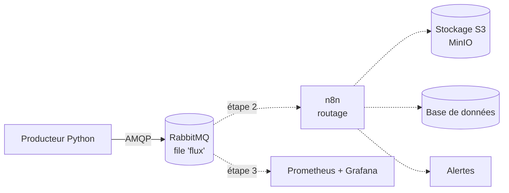

# dataflow-lab

Pipeline de données conteneurisé pour expérimenter le **transport**, le **routage** et la **supervision** de flux de messages.

Projet personnel mené en autoformation pour comprendre concrètement les problématiques de bus de messages, d'intégration et d'observabilité rencontrées dans les architectures orientées données.

## Objectifs

- Faire transiter des messages entre des services qui ne se connaissent pas (découplage)
- Garantir qu'aucun message n'est perdu en cas de panne ou de redémarrage
- Router dynamiquement les messages selon leur contenu
- Superviser le flux en temps réel (débit, file d'attente, erreurs)
- Documenter l'installation et l'exploitation comme pour une mise en production

## Architecture



Les traits pleins représentent ce qui fonctionne aujourd'hui, les pointillés les étapes à venir.

## Stack technique

| Composant | Rôle | Statut |
|---|---|---|
| Docker / Docker Compose | Conteneurisation et orchestration locale | ✅ |
| Python 3.12 + pika | Producteur de messages simulés | ✅ |
| RabbitMQ 3.13 | Bus de messages (file durable, messages persistants) | ✅ |
| n8n | Moteur d'intégration et routage dynamique | 🔜 |
| MinIO | Stockage objet compatible S3 | 🔜 |
| Prometheus + Grafana | Collecte de métriques et tableaux de bord | 🔜 |

## Démarrage rapide

### Prérequis

- Docker et Docker Compose (testé sous Ubuntu via WSL 2)
- Git

### Installation

```bash
git clone https://github.com/Dvxy67/dataflow-lab.git
cd dataflow-lab
cp .env.example .env    # puis adapter les identifiants
docker compose up -d --build
```

### Vérification

```bash
docker compose ps              # les deux services doivent être "running", RabbitMQ "healthy"
docker compose logs -f producteur
```

Interface d'administration RabbitMQ : http://localhost:15672 (identifiants définis dans `.env`). La file `flux` se remplit d'un message par seconde.

### Arrêt

```bash
docker compose down
```

## Configuration

Les identifiants ne sont jamais versionnés : ils sont lus depuis un fichier `.env`, exclu par `.gitignore`. Le fichier `.env.example` liste les variables attendues.

| Variable | Description |
|---|---|
| `RABBITMQ_USER` | Utilisateur RabbitMQ |
| `RABBITMQ_PASS` | Mot de passe RabbitMQ |

L'intervalle d'envoi du producteur se règle via `INTERVALLE` dans `docker-compose.yml` (en secondes).

## Format des messages

```json
{
  "type": "alerte",
  "source": "serveur-03",
  "valeur": 57,
  "date": "2026-11-08T12:10:42"
}
```

Le champ `type` (`log`, `mesure`, `fichier`, `alerte`) servira de clé de routage à l'étape 2.

## Choix techniques

- **Healthcheck sur RabbitMQ** : le producteur ne démarre qu'une fois le bus réellement prêt (`depends_on: condition: service_healthy`), et non simplement lancé.
- **Reconnexion automatique** : le producteur réessaie de se connecter si le bus est indisponible, au lieu de planter.
- **Persistance** : file déclarée `durable` et messages publiés en `delivery_mode=2`, pour survivre à un redémarrage du broker.
- **Optimisation du cache Docker** : `requirements.txt` est copié avant le code source, pour ne pas réinstaller les dépendances à chaque modification du script.

## Observations

- Après un redémarrage complet de RabbitMQ, la file `flux` et ses messages sont récupérés (`Recovering 1 queues of type rabbit_classic_queue` dans les logs).
- Sans consommateur, les messages s'accumulent dans la file sans perte : le bus absorbe l'absence temporaire d'un service.

## Feuille de route

- [x] **Étape 1** : producteur Python + RabbitMQ conteneurisés, persistance des messages
- [ ] **Étape 2** : routage dynamique des messages avec n8n vers S3 (MinIO), base de données et alertes
- [ ] **Étape 3** : supervision avec Prometheus et Grafana (exporter natif RabbitMQ)
- [ ] **Étape 4** : variante avec Kafka à la place de RabbitMQ et comparaison des deux approches

## Structure du projet

```
dataflow-lab/
├── docker-compose.yml
├── .env.example
├── .gitignore
└── producteur/
    ├── Dockerfile
    ├── producteur.py
    └── requirements.txt
```

## Auteur

Jean Ardaillou · [github.com/Dvxy67](https://github.com/Dvxy67)
