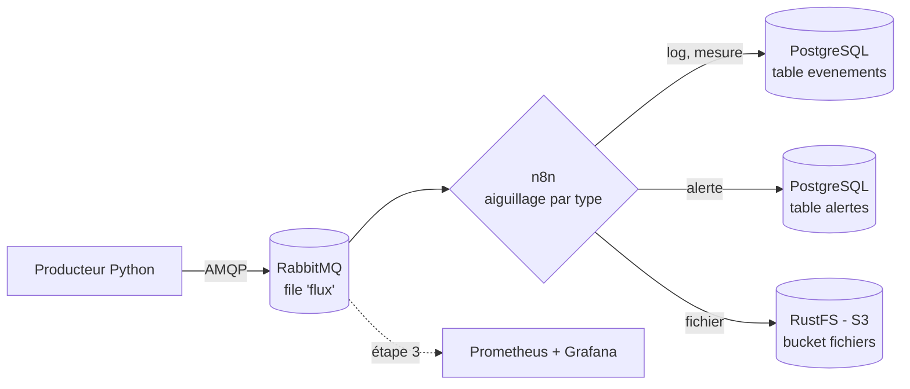

# dataflow-lab

Pipeline de données conteneurisé pour expérimenter le **transport**, le **routage dynamique** et la **supervision** de flux de messages.

Projet personnel mené en autoformation pour comprendre concrètement les problématiques de bus de messages, d'intégration et d'observabilité rencontrées dans les architectures orientées données.

## Objectifs

- Faire transiter des messages entre des services qui ne se connaissent pas (découplage)
- Garantir qu'aucun message n'est perdu en cas de panne ou de redémarrage
- Router dynamiquement les messages selon leur contenu
- Superviser le flux en temps réel (débit, file d'attente, erreurs)
- Documenter l'installation et l'exploitation comme pour une mise en production

## Architecture



Les traits pleins représentent ce qui fonctionne aujourd'hui, les pointillés l'étape à venir.

## Stack technique

| Composant | Rôle | Statut |
|---|---|---|
| Docker / Docker Compose | Conteneurisation et orchestration locale | ✅ |
| Python 3.12 + pika | Producteur de messages simulés | ✅ |
| RabbitMQ 3.13 | Bus de messages (file durable, messages persistants) | ✅ |
| n8n | Moteur d'intégration : consommation et routage dynamique | ✅ |
| PostgreSQL 16 | Stockage des événements et des alertes | ✅ |
| RustFS | Stockage objet compatible S3 | ✅ |
| Prometheus + Grafana | Collecte de métriques et tableaux de bord | 🔜 |

## Démarrage rapide

### Prérequis

- Docker et Docker Compose (testé sous Ubuntu via WSL 2, 8 Go de RAM)
- Git

### Installation

```bash
git clone https://github.com/Dvxy67/dataflow-lab.git
cd dataflow-lab
cp .env.example .env    # puis remplacer toutes les valeurs "changeme"
docker compose up -d --build
docker compose ps       # 5 services "running", rabbitmq et postgres "healthy"
```

### Configuration de n8n

1. Ouvrir http://localhost:5678 et créer le compte propriétaire (local).
2. Créer trois connexions (*credentials*), en utilisant les noms de service Docker comme hôtes :
   - **RabbitMQ** : hôte `rabbitmq`, port `5672`
   - **Postgres** : hôte `postgres`, port `5432`, base `dataflow`
   - **S3** : endpoint `http://rustfs:9000`, région `us-east-1`, *Force Path Style* activé
3. Importer le workflow `n8n/workflow-routage.json`, associer les connexions à chaque nœud, puis publier.

### Configuration du stockage S3

Ouvrir la console RustFS sur http://localhost:9001 et créer le bucket `fichiers`.

### Vérification

```bash
# Messages enregistrés par type
docker exec -it postgres psql -U <POSTGRES_USER> -d dataflow \
  -c "SELECT type, COUNT(*) FROM evenements GROUP BY type;"

# Consommation des ressources
docker stats --no-stream
```

Interfaces : RabbitMQ http://localhost:15672 · n8n http://localhost:5678 · RustFS http://localhost:9001

### Arrêt

```bash
docker compose down
```

Les données sont conservées dans des volumes Docker (`n8n_data`, `postgres_data`, `minio_data`).

## Configuration

Les identifiants ne sont jamais versionnés : ils sont lus depuis un fichier `.env`, exclu par `.gitignore`. Le fichier `.env.example` liste les variables attendues, avec des valeurs fictives.

| Variable | Description |
|---|---|
| `RABBITMQ_USER` / `RABBITMQ_PASS` | Identifiants RabbitMQ |
| `MINIO_USER` / `MINIO_PASS` | Identifiants du stockage S3 (RustFS) |
| `POSTGRES_USER` / `POSTGRES_PASS` | Identifiants PostgreSQL |

## Format des messages

```json
{
  "type": "alerte",
  "source": "serveur-03",
  "valeur": 57,
  "date": "2026-11-08T12:10:42"
}
```

## Routage

Le workflow n8n `Routage des flux` consomme la file `flux` et aiguille chaque message selon son champ `type` :

| Type | Destination |
|---|---|
| `log`, `mesure` | Table PostgreSQL `evenements` |
| `alerte` | Table PostgreSQL `alertes` |
| `fichier` | Converti en fichier JSON, puis déposé dans le bucket S3 `fichiers` |

Le workflow est versionné dans `n8n/workflow-routage.json` (sans aucun secret : les connexions n'y figurent que par leur nom).

## Choix techniques

- **Healthchecks** : le producteur et n8n ne démarrent qu'une fois RabbitMQ réellement prêt (`depends_on: condition: service_healthy`), et non simplement lancé.
- **Reconnexion automatique** : le producteur réessaie de se connecter si le bus est indisponible ou introuvable, au lieu de planter.
- **Persistance** : file déclarée `durable` et messages publiés en `delivery_mode=2`, pour survivre à un redémarrage du broker.
- **Limites de ressources** : chaque service a une limite mémoire (`mem_limit`), pour qu'aucun ne puisse saturer la machine.
- **Redémarrage automatique** : `restart: unless-stopped` sur tous les services.
- **Initialisation de la base** : les tables sont créées au premier démarrage via `postgres/init.sql`, monté en lecture seule.
- **Allègement de n8n** : les exécutions réussies ne sont pas enregistrées (`EXECUTIONS_DATA_SAVE_ON_SUCCESS: none`), seules les erreurs sont conservées pour le débogage.
- **Optimisation du cache Docker** : `requirements.txt` est copié avant le code source. Une modification du script ne reconstruit que la dernière couche (build en ~1,5 s).

## Observations

- **Absorption d'un retard** : après plusieurs heures sans consommateur, plusieurs centaines de messages en attente ont été traités en une dizaine de secondes à l'activation du workflow n8n, sans aucune perte.
- **Persistance** : après un redémarrage complet de RabbitMQ, la file `flux` et ses messages sont récupérés (`Recovering 1 queues of type rabbit_classic_queue`).
- **Découplage** : sans consommateur, les messages s'accumulent dans la file. Le bus absorbe l'absence temporaire d'un service.
- **Redémarrage du poste** : seuls les services configurés avec une politique de redémarrage sont relancés automatiquement, d'où son ajout sur l'ensemble des services.

## Incidents rencontrés

### Boucle de redémarrage du producteur

- **Symptôme** : le conteneur `producteur` en état `Restarting (1)` en continu.
- **Diagnostic** : les logs montraient `socket.gaierror: Name or service not known`. RabbitMQ n'avait pas redémarré, et son nom n'était plus résolu sur le réseau Docker.
- **Cause** : la logique de reconnexion ne gérait que `AMQPConnectionError` (broker présent mais indisponible), pas l'absence totale du service.
- **Correctif** : gestion des erreurs `OSError` dans la reconnexion, et ajout de `restart: unless-stopped` sur RabbitMQ.

### Saturation du poste de travail

- **Symptôme** : surchauffe, terminal figé, service WSL ne répondant plus (`Wsl/Service/0x8007274c`).
- **Cause** : cinq services lancés sans limite de ressources sur un poste de 8 Go de RAM, avec un message par seconde enregistré individuellement par n8n.
- **Correctifs** : limitation de WSL à 4 Go et 2 cœurs (`.wslconfig`), limites mémoire par conteneur, débit du producteur réduit à un message toutes les 5 secondes, désactivation de l'enregistrement des exécutions réussies dans n8n.

### Disparition de l'image MinIO

- **Symptôme** : `pull access denied for minio/minio, repository does not exist`.
- **Cause** : MinIO a cessé de publier les images de son édition communautaire et archivé son projet en 2026.
- **Correctif** : remplacement par RustFS, alternative compatible S3 activement maintenue. Aucune modification du workflow n'a été nécessaire, puisque l'API S3 est identique.
- **Enseignement** : une dépendance externe peut disparaître du jour au lendemain. D'où l'intérêt de figer les versions d'images et de surveiller l'état des outils utilisés.

## Feuille de route

- [x] **Étape 1** : producteur Python + RabbitMQ conteneurisés, persistance des messages
- [x] **Étape 2** : routage dynamique avec n8n vers PostgreSQL et un stockage S3 (RustFS)
- [ ] **Étape 3** : supervision avec Prometheus et Grafana (exporter natif RabbitMQ)
- [ ] **Étape 4** : variante avec Kafka à la place de RabbitMQ et comparaison des deux approches
- [ ] Figer les versions de toutes les images (n8n, RustFS)

## Structure du projet

```
dataflow-lab/
├── docker-compose.yml
├── .env.example
├── .gitignore
├── n8n/
│   └── workflow-routage.json
├── postgres/
│   └── init.sql
└── producteur/
    ├── Dockerfile
    ├── producteur.py
    └── requirements.txt
```

## Auteur

Jean Ardaillou · [github.com/Dvxy67](https://github.com/Dvxy67)
