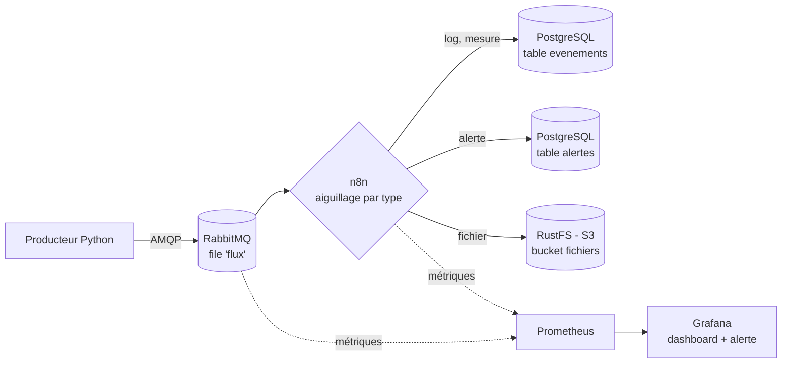
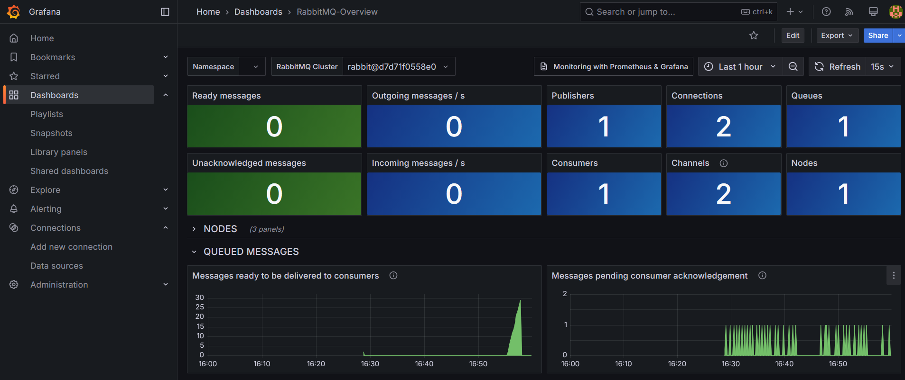
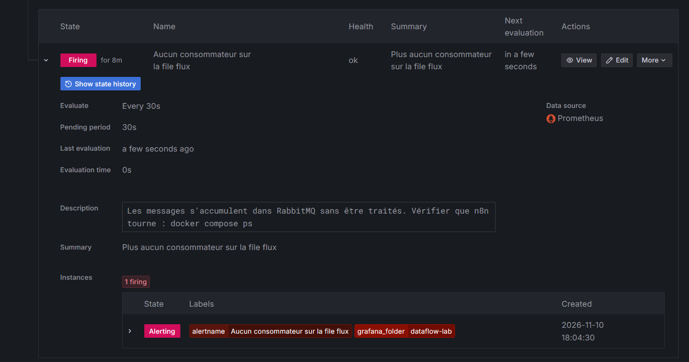

# dataflow-lab

Pipeline de données conteneurisé pour expérimenter le **transport**, le **routage dynamique** et la **supervision** de flux de messages.

Projet personnel mené en autoformation pour comprendre concrètement les problématiques de bus de messages, d'intégration et d'observabilité rencontrées dans les architectures orientées données.

## Objectifs

- Faire transiter des messages entre des services qui ne se connaissent pas (découplage)
- Garantir qu'aucun message n'est perdu en cas de panne ou de redémarrage
- Router dynamiquement les messages selon leur contenu
- Superviser le flux en temps réel et être alerté en cas d'incident
- Décrire toute la configuration sous forme de fichiers versionnés (infrastructure as code)

## Architecture



## Stack technique

| Composant | Rôle | Version |
|---|---|---|
| Docker / Docker Compose | Conteneurisation et orchestration locale | — |
| Python + pika | Producteur de messages simulés | 3.12 |
| RabbitMQ | Bus de messages (file durable, messages persistants) | 3.13 |
| n8n | Moteur d'intégration : consommation et routage dynamique | latest |
| PostgreSQL | Stockage des événements et des alertes | 16 |
| RustFS | Stockage objet compatible S3 | latest |
| Prometheus | Collecte et stockage des métriques | 3.1.0 |
| Grafana | Tableaux de bord et alertes | 11.5.0 |

## Démarrage rapide

### Prérequis

- Docker et Docker Compose (testé sous Ubuntu via WSL 2, 8 Go de RAM)
- Git

### Installation

```bash
git clone https://github.com/Dvxy67/dataflow-lab.git
cd dataflow-lab
cp .env.example .env    # puis remplacer toutes les valeurs "changeme"
docker compose up -d --build
docker compose ps       # 7 services "running", rabbitmq et postgres "healthy"
```

### Configuration de n8n

1. Ouvrir http://localhost:5678 et créer le compte propriétaire (local).
2. Créer trois connexions (*credentials*), en utilisant les noms de service Docker comme hôtes :
   - **RabbitMQ** : hôte `rabbitmq`, port `5672`
   - **Postgres** : hôte `postgres`, port `5432`, base `dataflow`
   - **S3** : endpoint `http://rustfs:9000`, région `us-east-1`, *Force Path Style* activé
3. Importer le workflow `n8n/workflow-routage.json`, associer les connexions à chaque nœud, puis publier.

### Configuration du stockage S3

Ouvrir la console RustFS sur http://localhost:9001 et créer le bucket `fichiers`.

### Supervision

Aucune configuration manuelle : la source de données Prometheus, le dashboard RabbitMQ et la règle d'alerte sont **provisionnés automatiquement** au démarrage de Grafana, à partir du dossier `grafana/provisioning/`.

### Interfaces

| Service | Adresse |
|---|---|
| RabbitMQ | http://localhost:15672 |
| n8n | http://localhost:5678 |
| RustFS | http://localhost:9001 |
| Prometheus | http://localhost:9090 |
| Grafana | http://localhost:3000 |

### Arrêt

```bash
docker compose down
```

Les données sont conservées dans des volumes Docker.

## Configuration

Les identifiants ne sont jamais versionnés : ils sont lus depuis un fichier `.env`, exclu par `.gitignore`. Le fichier `.env.example` liste les variables attendues, avec des valeurs fictives.

| Variable | Description |
|---|---|
| `RABBITMQ_USER` / `RABBITMQ_PASS` | Identifiants RabbitMQ |
| `MINIO_USER` / `MINIO_PASS` | Identifiants du stockage S3 (RustFS) |
| `POSTGRES_USER` / `POSTGRES_PASS` | Identifiants PostgreSQL |
| `GRAFANA_USER` / `GRAFANA_PASS` | Identifiants administrateur Grafana |

## Routage

Le workflow n8n `Routage des flux` consomme la file `flux` et aiguille chaque message selon son champ `type` :

| Type | Destination |
|---|---|
| `log`, `mesure` | Table PostgreSQL `evenements` |
| `alerte` | Table PostgreSQL `alertes` |
| `fichier` | Converti en fichier JSON, puis déposé dans le bucket S3 `fichiers` |

## Supervision et alerte

Prometheus collecte toutes les 15 secondes les métriques de RabbitMQ (port natif 15692), de n8n et de lui-même. Grafana les affiche dans le dashboard officiel **RabbitMQ-Overview**.

Une règle d'alerte surveille le nombre de consommateurs de la file :

| Paramètre | Valeur | Raison |
|---|---|---|
| Requête | `sum(rabbitmq_queue_consumers)` | Nombre total de consommateurs |
| Condition | inférieur à 1 | Plus personne ne traite les messages |
| Évaluation | toutes les 30 s | |
| Délai avant déclenchement | 1 min | Évite les fausses alertes lors d'un simple redémarrage |
| Absence de données | traitée comme une alerte | Si RabbitMQ tombe, plus aucune métrique n'arrive : le silence n'est pas une bonne nouvelle |

### Incident simulé : arrêt du consommateur

Arrêt volontaire de n8n (`docker compose stop n8n`), puis redémarrage :



Les messages s'accumulent dans la file pendant la panne, puis sont absorbés en quelques secondes au retour de n8n, sans aucune perte.



L'alerte passe de *Normal* à *Pending*, puis à *Firing* au bout d'une minute, et se résout automatiquement au retour du consommateur.

## Choix techniques

- **Healthchecks** : le producteur et n8n ne démarrent qu'une fois RabbitMQ réellement prêt (`depends_on: condition: service_healthy`).
- **Reconnexion automatique** : le producteur réessaie de se connecter si le bus est indisponible ou introuvable, au lieu de planter.
- **Persistance** : file déclarée `durable` et messages publiés en `delivery_mode=2`.
- **Limites de ressources** : chaque service a une limite mémoire (`mem_limit`).
- **Redémarrage automatique** : `restart: unless-stopped` sur tous les services.
- **Initialisation de la base** : tables créées au premier démarrage via `postgres/init.sql`, monté en lecture seule.
- **Provisioning Grafana** : source de données, dashboard et alerte décrits en fichiers et rechargés à chaque démarrage. Vérifié en supprimant le dashboard et l'alerte dans l'interface : ils sont recréés au redémarrage de Grafana.
- **Versions figées** : Prometheus et Grafana sont épinglés sur une version précise, suite à l'incident MinIO.
- **Rétention limitée** : Prometheus ne conserve que 7 jours de métriques.
- **Allègement de n8n** : les exécutions réussies ne sont pas enregistrées, seules les erreurs sont conservées.
- **Optimisation du cache Docker** : `requirements.txt` est copié avant le code source.

## Observations

- **Absorption d'un retard** : après plusieurs heures sans consommateur, plusieurs centaines de messages en attente ont été traités en une dizaine de secondes, sans perte.
- **Persistance** : après un redémarrage complet de RabbitMQ, la file `flux` et ses messages sont récupérés.
- **Acquittement** : chaque message reste « non acquitté » une fraction de seconde, le temps que n8n le traite. Des messages qui resteraient non acquittés signaleraient un consommateur bloqué.

## Incidents rencontrés

### Boucle de redémarrage du producteur

- **Symptôme** : conteneur `producteur` en état `Restarting (1)` en continu.
- **Diagnostic** : les logs montraient `socket.gaierror: Name or service not known`.
- **Cause** : la reconnexion ne gérait que `AMQPConnectionError`, pas l'absence totale du service RabbitMQ.
- **Correctif** : gestion des erreurs `OSError`, et ajout de `restart: unless-stopped` sur RabbitMQ.

### Saturation du poste de travail

- **Symptôme** : surchauffe, terminal figé, service WSL ne répondant plus.
- **Cause** : cinq services sans limite de ressources sur un poste de 8 Go, et un enregistrement par message dans n8n.
- **Correctifs** : WSL limité à 4 Go, limites mémoire par conteneur, débit du producteur réduit, enregistrement des exécutions réussies désactivé.

### Disparition de l'image MinIO

- **Symptôme** : `pull access denied for minio/minio, repository does not exist`.
- **Cause** : MinIO a cessé de publier les images de son édition communautaire et archivé son projet en 2026.
- **Correctif** : remplacement par RustFS, compatible S3, sans modification du workflow.
- **Enseignement** : une dépendance externe peut disparaître du jour au lendemain, d'où l'intérêt de figer les versions et de surveiller les outils utilisés.

## Feuille de route

- [x] **Étape 1** : producteur Python + RabbitMQ conteneurisés, persistance des messages
- [x] **Étape 2** : routage dynamique avec n8n vers PostgreSQL et un stockage S3 (RustFS)
- [x] **Étape 3** : supervision avec Prometheus et Grafana, alerte sur l'absence de consommateur, provisioning complet
- [ ] **Étape 4** : variante avec Kafka à la place de RabbitMQ et comparaison des deux approches
- [ ] Figer les versions de n8n et RustFS
- [ ] Brancher un canal de notification (e-mail ou Discord) sur l'alerte

## Structure du projet

```
dataflow-lab/
├── docker-compose.yml
├── .env.example
├── .gitignore
├── docs/                           # captures d'écran
├── grafana/provisioning/
│   ├── datasources/prometheus.yml
│   ├── dashboards/                 # dashboard RabbitMQ-Overview
│   └── alerting/alertes.yaml
├── n8n/workflow-routage.json
├── postgres/init.sql
├── prometheus/prometheus.yml
└── producteur/
    ├── Dockerfile
    ├── producteur.py
    └── requirements.txt
```

## Auteur

Jean Ardaillou · [github.com/Dvxy67](https://github.com/Dvxy67)
